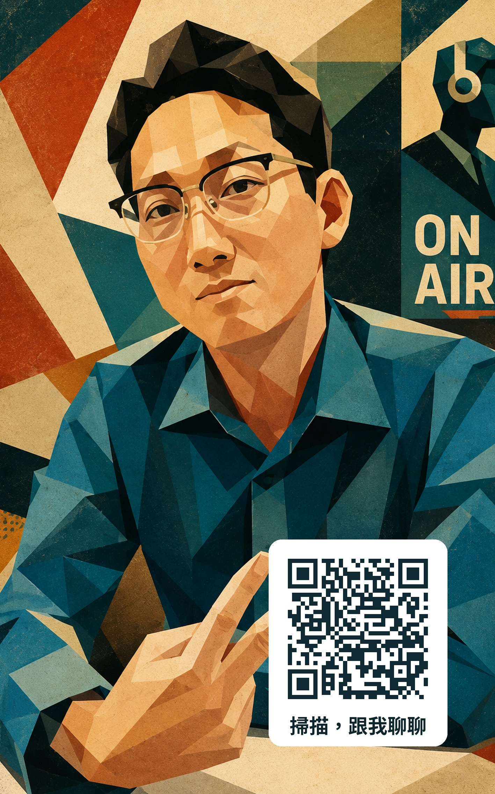
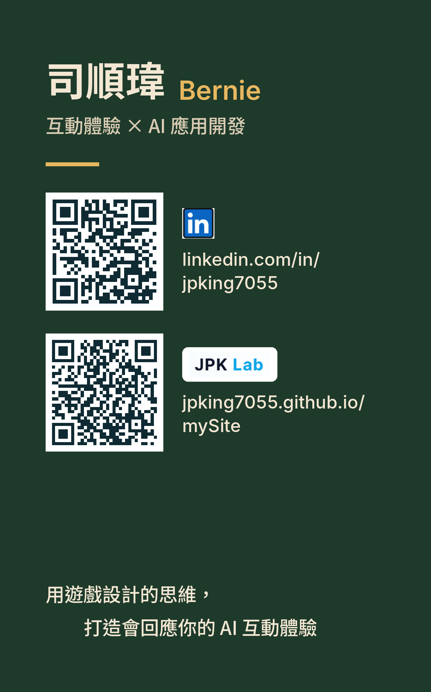

# AR 互動名片｜司順瑋 Bernie

用手機掃描名片，名片上的低多邊形人像會「站起來」，跟你打招呼、自我介紹。

- 線上版：https://jpking7055.github.io/ar-business-card/
- 技術：[MindAR](https://hiukim.github.io/mind-ar-js-doc/)（圖片追蹤）＋ A-Frame（three.js）
- 目前進度：第一階段（純前端、GitHub Pages）。角色播放本人錄音自我介紹，嘴型依音量開合。
- 下一階段：接上 Gemini Live，讓角色可以即時語音對話。

| 正面（AR 辨識） | 背面（聯絡資訊） |
| --- | --- |
|  |  |

## 使用流程

1. 用手機相機掃名片正面的 QR Code。
2. 開啟網頁、允許使用鏡頭。
3. 把鏡頭對準名片正面，角色會從名片上彈出來。
4. 按「跟我打招呼」，角色會用本人的聲音自我介紹。

正面 QR Code 先連到 `jpking7055.github.io/mySite/card.html`，再轉到這個專案。AR 網頁換網址時只要改那一頁，已經發出去的名片不用重印。

## 專案結構

```
index.html                 AR 頁面（MindAR + A-Frame）
targets.mind               名片正面的辨識檔
avatar/                    角色狀態圖（網頁用，WebP）
audio/
  intro.m4a                  自我介紹錄音（已裁切、音量標準化）
  intro.json                 嘴型用的音量曲線（每 40ms 一格）
  idle / talking / greet / greet_talking
design/                    名片與角色的原始素材
  portrait_source.png        低多邊形人像原圖（名片正面主視覺）
  avatar-source/             AI 生成的角色原圖（比 YA 閉嘴／張嘴、雙手平放張嘴）
  qr/                        三個 QR Code（SVG）
  card_front_print.jpg       正面印刷圖（600 dpi，含 3 mm 出血）
  card_back_print.png        背面印刷圖（600 dpi，含 3 mm 出血）
  card_print_A4.pdf          A4 測試列印檔（實際尺寸，含裁切線）
  mindar_target_front.png    給 MindAR 編譯用的正面圖（不含出血）
tools/                     重現素材的腳本
  make_qr.py                 產生 QR Code
  build_avatar.py            角色圖對齊、補嘴型、去背、輸出 WebP
  render_print.py            產生印刷圖、A4 PDF、MindAR 辨識圖
  make_voice.py              錄音裁切、標準化，並算出嘴型音量曲線
```

## 製作流程

### 1. 角色造型

1. 用 AI 圖片生成，把自己的照片轉成低多邊形（low-poly）紙質風格的人像，作為名片正面主視覺（`design/portrait_source.png`）。
2. 以這張為參考，生成白底、坐在小桌前的半身角色。
   - 先生成一張「基本圖」並定稿，之後每個狀態都拿**同一張基本圖**當參考，只改局部，避免越改越不像。
   - 比例要寫實：頭太大會變 Q 版，配上寫實五官會很詭異。修正時一次只改一件事（例如「頭縮小約 15%，其他不變」）。
3. 需要的狀態：
   - **greet**：比 YA 打招呼（閉嘴）
   - **greet_talking**：同上、張嘴
   - **talking**：雙手平放、張嘴
   - **idle**：雙手平放、閉嘴（由腳本合成，見下一步）

### 2. 角色圖處理（`tools/build_avatar.py`）

切換狀態時，除了嘴巴以外都不能動，否則人物會抖動。腳本做了這些事：

- **檢查對齊**：生成的「雙手平放閉嘴」圖身體色塊整個重畫過（約 13% 像素不同），不能用。改用「雙手平放張嘴」當底，把比 YA 閉嘴圖的嘴巴（橢圓範圍、邊緣淡化）貼上去，做出 idle。
- **去背**：去掉白色背景，包括從外圍連通的白色，以及被手臂圍住、面積較大的白色區塊（腋下）。眼鏡反光、牙齒等小白點會保留。
- **統一裁切**：四張用同一個裁切範圍，確保切換時完全對齊。
- **輸出**：寬 600 px 的 WebP，四張合計約 270 KB。

### 3. 名片設計

- **尺寸**：直式 54×90 mm，四邊各 3 mm 出血。
- **正面**：人像鋪滿整面，右下角白底 QR Code（約 2 cm），標示「掃描，跟我聊聊」。人像色塊多、對比強、不對稱，很適合當 AR 辨識目標；QR Code 也會增加特徵點。
- **背面**：深藍綠底（#13343d）配米色字（#f3e7d3）、橘色強調（#e0814a），色調取自人像。內容：
  - 司順瑋 Bernie／互動體驗 × AI 應用開發
  - LinkedIn 與作品集各一個 QR Code，附圖示與短網址
  - 標語：用遊戲設計的思維，打造會回應你的 AI 互動體驗
- 背面用 LinkedIn 取代 Email，作為公開的聯絡方式。
- QR Code 用 `tools/make_qr.py` 產生，並用程式解碼確認網址正確。
- 設計稿在設計畫布上完成；印刷檔用 `tools/render_print.py` 產生。

### 4. 印刷

- **測試**：`design/card_print_A4.pdf` 已經把名片按實際尺寸排在 A4 上（兩正兩背、含裁切線）。超商印一般紙即可，頁首有一條 5 cm 的線可以確認比例。貼在硬紙板上測 AR 和 QR Code。
- **正式**：到印刷店做霧面紙、300 磅以上。避免亮面、燙金、燙銀，反光會影響辨識。

### 5. AR 辨識檔

1. 用裁掉出血的正面圖 `design/mindar_target_front.png`（600×1000 px，與裁切後的名片範圍一致）。
2. 上傳到 [MindAR Image Targets Compiler](https://hiukim.github.io/mind-ar-js-doc/tools/compile)，確認特徵點分布均勻（臉、襯衫、手、QR Code 都有）。
3. 下載 `targets.mind`，放在專案根目錄。

名片正面設計有任何修改，都要重新產生辨識圖並重新編譯。

### 6. AR 頁面（`index.html`）

- **座標**：名片寬 = 1，高 ≈ 1.667，+Z 朝名片外。
- **站立與轉向**：依觀看角度調整，並做平滑處理避免抖動。
  - 從正前方看（名片拿起來、或手機在名片正上方）：角色平貼在名片上，頭朝名片上緣，不會顛倒。
  - 名片平放、從下緣斜看：角色以腳下為支點立起來，並轉向觀看者（最多 ±60°）。
  - 腳下有一圈半透明陰影。
- **重新辨識**：登場動畫用事件觸發，名片移出畫面再移回來時會重播。
- **登場**：辨識到名片時，人像變暗、角色彈出（greet），約 2.5 秒後換成待機（idle）。名片移出畫面時角色消失。
- **說話**：按鈕播放本人錄音 `audio/intro.m4a`，依播放時間查 `audio/intro.json` 的音量：有聲音時每 80ms 開合一次，停頓時閉嘴。iPhone 必須由使用者點擊後才能播放聲音，所以做成按鈕。錄音無法播放時，退回瀏覽器內建語音念 `INTRO`。
- **為什麼預先算音量**：iPhone 上把聲音接進 Web Audio 即時分析，會受靜音開關影響而沒有聲音；預先算好就能用一般的 `<audio>` 播放。
- **除錯**：網址加上 `?debug=1`，左上角顯示顯示狀態、縮放、站立／轉向角度、姿勢與圖片載入狀態，角色位置會有洋紅色小方塊。
- **防抖**：`filterMinCF: 0.0001; filterBeta: 0.001`，減少追蹤抖動。
- 換錄音：`python tools/make_voice.py 新錄音.m4a`，會自動裁掉前後空白、標準化音量，並重算音量曲線。

### 7. 部署

1. 推上 GitHub，Settings → Pages 選 main 分支、根目錄。
2. 在 mySite 加上 `card.html`，轉址到 `https://jpking7055.github.io/ar-business-card/`。
3. 用印好的名片實測：QR Code、追蹤穩定度、不同光線下的反光。

## 本機測試

鏡頭需要 HTTPS 或 localhost：

```bash
npx serve .
```

手機測試建議直接用 GitHub Pages 的網址。

## 重新產生素材

```bash
python -m venv .venv
.venv\Scripts\Activate.ps1          # Windows PowerShell
pip install -r requirements.txt
python tools/make_qr.py        # QR Code
python tools/build_avatar.py   # 角色狀態圖
python tools/render_print.py   # 印刷圖、A4 PDF、MindAR 辨識圖
python tools/make_voice.py 錄音.m4a   # 自我介紹語音（需要 ffmpeg）
```

`render_print.py` 需要 Noto Sans CJK TC 與 Inter 字型，路徑在檔案開頭的 `FONT_DIR`、`LATIN_DIR`。

## 下一階段：即時語音對話

- 以 [Lumi-AI-Lab](https://github.com/JPKing7055/Lumi-AI-Lab) 的 Express 架構為底，部署到 Cloud Run。
- 搬入 [multimodal-assistant](https://github.com/JPKing7055/multimodal-assistant) 的 Gemini Live client 與音訊模組；後端只負責發臨時金鑰（ephemeral token），API 金鑰不進前端、不進 repo。
- 嘴型改成依 Live 回傳語音的音量切換。
- 角色的自我介紹與專案內容先寫在系統提示；內容變多時再參考 [RAG-reference](https://github.com/JPKing7055/RAG-reference) 加入檢索。
